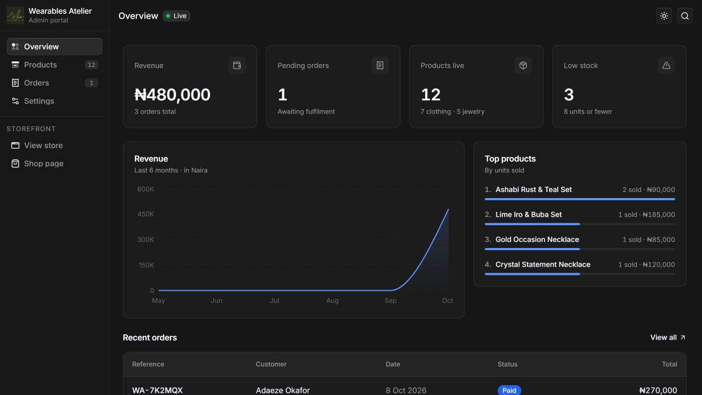

# Wearables Atelier admin

Separate admin console for catalog management, inventory, customers, orders, sales reports and store settings. It retains the original ObsidianUI dashboard style with the supplied Wearables by Ashabi logo. This repository contains no customer storefront routes.



Source: [wearables-atelier-admin](https://github.com/Trust-Code-System/wearables-atelier-admin). Customer app: [wearables-atelier-storefront](https://github.com/Trust-Code-System/wearables-atelier-storefront).

Live admin: [wearables-atelier-admin.vercel.app/admin](https://wearables-atelier-admin.vercel.app/admin). Live customer site: [wearables-atelier-storefront.vercel.app](https://wearables-atelier-storefront.vercel.app).

## Run locally

Use Node.js 22 LTS or newer:

```sh
npm ci
cp .env.example .env.local
npm run dev
```

Open [localhost:3200/admin](http://localhost:3200/admin). `/` redirects there. Product, order and settings paths keep their `/admin` prefix. Start the separate storefront from its own folder at `http://localhost:3100`.

Verify with `npm run lint`, `npm test` and `npm run build`. Run the production build locally with `npm run start -- --port 3200`.

## Configure storefront links

Copy `.env.example` to `.env.local` and set:

```dotenv
NEXT_PUBLIC_STOREFRONT_URL=http://localhost:3100
```

For deployment use the storefront's actual HTTPS address. This value is public and inlined during the build; rebuild when changing it. Dashboard and search links use this address to open the other app. It must be an HTTP/HTTPS URL.

## Backend configuration

Both apps use the same public backend setting:

```dotenv
NEXT_PUBLIC_API_BASE_URL=https://api.staging.wearables.trustcodesystem.tech
```

Keep `.env.local` at the project root and out of Git. `.env.example` includes both this staging address and the local storefront-link setting. Preserve `NEXT_PUBLIC_STOREFRONT_URL` when updating your environment file.

Future API code can import `getApiBaseUrl` from `@/lib/api-config` and append the backend's confirmed endpoint path. The helper validates the setting and removes trailing slashes; it makes no network requests. No API prefix, authentication scheme or endpoint contract is assumed.

Set `NEXT_PUBLIC_API_BASE_URL` in this Vercel project's **Production**, **Preview** and **Development** environments for now, matching the storefront project. This value is public and inlined at build time: restart local development after changes and rebuild/redeploy hosted apps when changing it. Replace the Production value when the production backend is available. Never use `NEXT_PUBLIC_` variables for tokens or API keys.

Configured in both projects under the `hello-76386237s-projects` Vercel workspace on 14 October 2026, for all three environments. Existing deployments need a new build to receive the setting.

This prepares configuration only. Demo data, browser storage and admin workflows remain unchanged until API integration. Backend CORS and admin authentication must be configured when those integrations start.

## Structure

- `src/app/admin` — overview, products, inventory, customers, analytics, order management and settings.
- `src/components/admin` — search, view state and revenue chart.
- `src/components/block/dashboard-shell.*` — ObsidianUI shell.
- `src/lib/store.tsx` — prototype catalog, order and settings stores.
- `src/lib/storefront-url.ts` — external customer-app links.
- `src/lib/api-config.ts` — validated public base URL for future API integration.
- `public/brand` and `public/collection` — independent copies of brand assets.

Next.js 16.4, React 19, Tailwind 4, Base UI, Radix, Duo Icons, Motion and Recharts. Each dependency and asset belongs to this repository; there is no parent workspace or sibling-folder runtime dependency. Inter/Geist fonts are fetched during a clean build.

The shell was adapted from the [official ObsidianUI dashboard shell registry](https://www.obsidianui.dev/r/dashboard-shell.json). Brand imagery comes from the owner's original website, with source attribution in `docs/brand-assets.md`.

## Prototype data

The owner chose to split the projects now and connect a shared backend next. Admin changes and storefront orders **do not sync yet**. This address starts with its own demo data; the original browser data is preserved at the storefront's old origin. Payment is simulated, and key fields are browser-storage placeholders. Do not enter live payment secrets here.

Inventory includes stock-level filters, total quantities, retail valuation, adjustments with reasons and a recent history. Customers are grouped from order contacts with purchase histories, not authenticated customer accounts. Orders support search, status filters, internal notes and courier/tracking details. Analytics uses paid and fulfilled orders only, with date filters and CSV exports. See [admin workflows](docs/admin-workflows.md) for behavior and limitations.

Administrator authentication is implemented at `/login`. All `/admin` pages require a current Better Auth session with an existing `admin` role or an email-verified `owner` role. The server verifies sessions before rendering the portal, the client checks navigation/session expiry, and backend guards independently authorize every protected API request using current database privileges. Sign out is available in the header. Customer and staff accounts cannot enter the portal; staff invitations and permissions are deferred.

The owner registers and verifies her own backend account, then an operator runs the backend's explicit `OWNER_BOOTSTRAP_EMAIL=client@example.com pnpm bootstrap:owner` command against the intended database after applying migrations. The command revokes old sessions; the owner signs in again with her existing credentials. It cannot transfer ownership or create a second owner. See the backend's `docs/admin-access.md`. Deploy the backend owner-access change before this admin update. The storefront's registration UI is not yet wired to the backend.

Products, images and inventory use the backend API. Other demo workflows described above remain prototypes. The storefront is a separate integration.

To create a local or staging admin, configure backend `ADMIN_SEED_EMAIL`, `ADMIN_SEED_PASSWORD` (12+ characters) and `ADMIN_SEED_NAME`, then run the backend's explicit `pnpm seed:admin` command after building and applying migrations. See the backend repository's `docs/admin-access.md` for staging instructions and refusal rules. This does not implement owner/staff invitations.

For hosted login, use `https://admin.wearables.trustcodesystem.tech/login`, set this project's `NEXT_PUBLIC_API_BASE_URL` to the configured HTTPS API origin, and configure backend `COOKIE_DOMAIN=wearables.trustcodesystem.tech` with the admin origin allowed in CORS/trusted origins. The `vercel.app` alias cannot receive that shared parent-domain cookie. Locally use `localhost` for both apps with backend `COOKIE_DOMAIN` empty.

## Deploy independently

Import **this repository** into its own Vercel or Next.js/Node.js hosting project. Use repository root `.`, install with `npm ci`, build with `npm run build`, and set `NEXT_PUBLIC_STOREFRONT_URL` in the build environment. Import the storefront repository as a separate hosting project. GitHub Pages cannot run these dynamic Next.js routes.

The source repository is public at the owner's request. This app is deployed as its own Vercel project under Trustcode System, with Git integration on `main`. The production and preview environments set `NEXT_PUBLIC_STOREFRONT_URL=https://wearables-atelier-storefront.vercel.app`. Deploy the backend changes before this admin integration, including its migrations and environment configuration.
